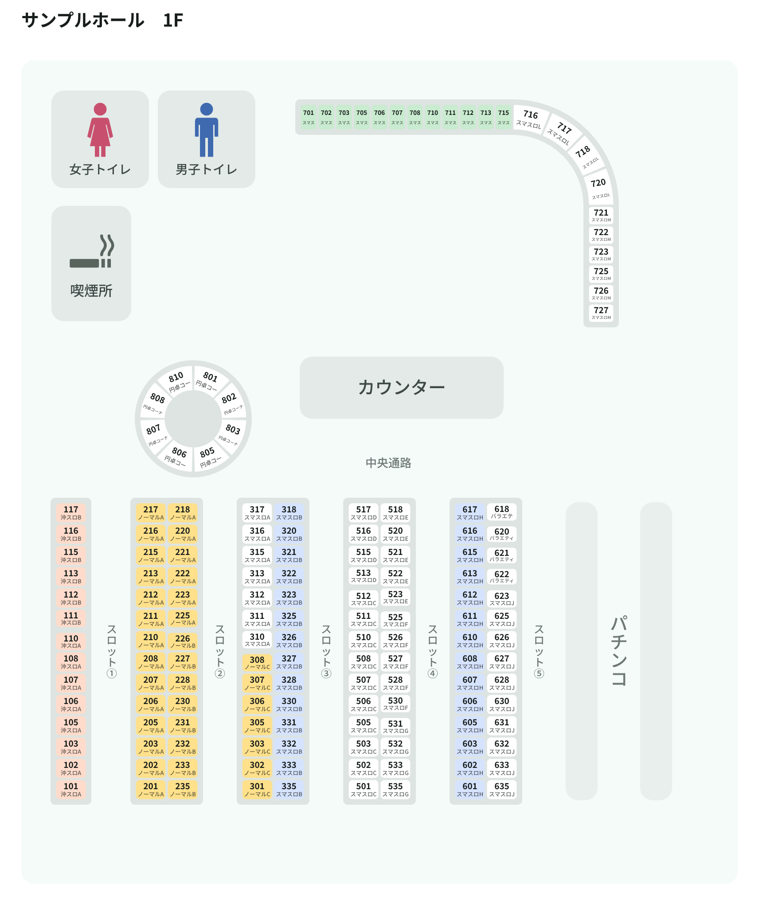

# 島図メーカー（slot-map-maker）

パチンコ・スロット店の島図を作り、画像（PNG / JPEG / SVG）として書き出すツールです。
`index.html` 1ファイルで動き、インストールもサーバーも不要です。

## できること

- 直線（片面・両面）、円弧、円卓、L字・U字・S字など、直線と円弧を自由につないだ島
- 複数フロア
- 台番号・機種名の入力（Enter で次の台へ、範囲選択、連番、Excel からの貼り付け）
- 機種ごとの色分け
- 部屋・設備（喫煙所、男子トイレ、女子トイレの専用マーク付き）、壁、床、文字
- 画像の書き出し、ファイルへの保存と読み込み

## 使い方

- ブラウザで使う：GitHub Pages の公開 URL を開く
- 手元で使う：このリポジトリをダウンロードし、`index.html` を Edge か Chrome で開く

操作の詳細は [使い方.txt](使い方.txt) と、画面右上の「使い方」にあります。

## データの扱い

作った島図はブラウザ内（localStorage）に自動保存され、外部には送信されません。
「保存」で `.shimazu.json` ファイルに書き出せます。
